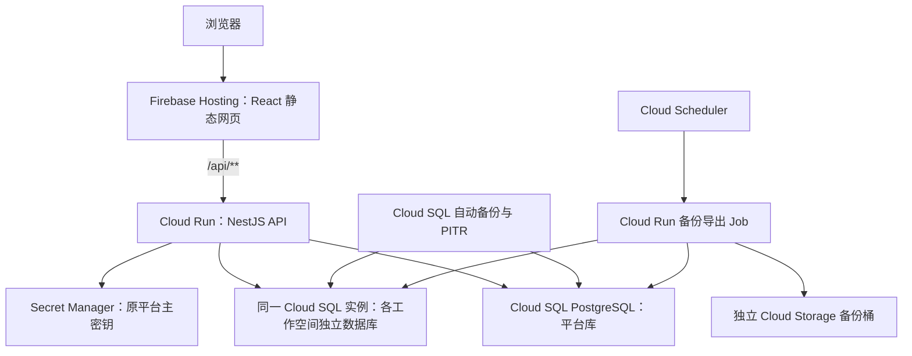

# Firebase 部署与定时数据库备份方案

核实日期：2026-11-10。适用版本：用户账号登录、多工作空间、平台目录库加每工作空间独立 SQLite。

本文为部署设计，不会创建云资源、修改现有数据库或执行迁移。文中的资源名和域名均为示例。

## 0. 当前零预算建议：直接 Docker

根据目前没有新增预算的约束，优先使用现有电脑、NAS 或已获得的免费 VM，直接运行当前 Docker Compose：同一容器已经同时提供前端和 API，可以继续使用现有每工作空间独立 SQLite，无需先迁移 PostgreSQL，也无需先接入 Firebase。

Docker 是运行方式，仍需要一台可持续运行、数据可持久保存的机器。可选位置：

| 位置 | 成本和条件 |
| --- | --- |
| 已有电脑 / NAS / 服务器 | 无需新增云托管费用，仍使用现有电力和网络；公网访问需有可达的 HTTPS 入口 |
| Oracle Always Free VM | 当前免费账户文档为 ARM 2 OCPU、12GB 内存；存在容量不足和空闲回收规则，必须保留异机备份 |
| Google Compute Engine 免费额度 | VM 有免费额度，但常规公网 IPv4 另按小时收费，严格零预算时不作为默认选择 |

Oracle 的额度与限制见[官方资源说明](https://docs.oracle.com/en-us/iaas/Content/FreeTier/freetier_topic-Always_Free_Resources.htm)。Google 标准 VM 的在用公网 IPv4 当前为 US$0.005/小时，只有每月一小时免费，持续使用约 US$3.6/月，未计其他费用。[Google 网络价格](https://cloud.google.com/vpc/network-pricing)

建议结构：

```text
浏览器 → HTTPS 反向代理 → Docker（前端 + NestJS API）
                           → 宿主机完整 DATA_DIR
宿主机定时任务 → 一致备份 → 另一台现有设备 / 私有免费额度存储
```

部署沿用 [Docker 使用与持久化](docker.md)。已有数据库继续使用原配置、原 `TOKEN_ENCRYPTION_KEY` 和完整 `DATA_DIR`，启动入口为 `docker compose up -d --build`。只运行一个访问该数据目录的应用实例；升级前停止旧实例并备份整套配置与数据。

零预算下的定时备份仍是必要功能，计划为每日北京时间 03:00 由宿主机执行：

1. 使用与正式服务相同的 Compose 项目、配置和可选覆盖文件；取得备份锁。
2. 优雅停止应用并确认停止，打包完整 `DATA_DIR`，暂存文件放在源目录外。
3. 无论打包成功或失败，都恢复服务并检查健康状态；本地一致副本生成后即可恢复服务，不必等异机复制完成。
4. 将备份复制到另一台现有电脑/NAS或私有对象存储，校验后才记为成功；同一硬盘的另一个目录只能算本地副本。
5. 原平台主密钥和部署配置单独加密保存；演示模式的 `platform-demo.key` 也必须保护。记录校验和、空间清单和应用版本。
6. 初期可保留最近 7 份日备份及 4 份周备份，按实际大小核算容量；失败或超过 26 小时无成功日备份需通知。

免费对象存储仍有总容量和操作数限制。例如 Oracle Always Free-only 状态的对象存储合计为 20GB；备份保留份数必须依据实际压缩大小调整，不能承诺无限免费空间。[Oracle 存储额度](https://docs.oracle.com/en-us/iaas/Content/FreeTier/freetier_topic-Always_Free_Resources.htm)

当前 Compose 的数据挂载已经支持容器重建后保留数据，但宿主机定时备份脚本、定时器和恢复演练尚需实际落地。本节仅调整部署方案，未启动服务或更改现有数据。以下 Firebase 路线保留供以后有预算或明确需要托管服务时采用。

## 1. 方案选择

Firebase Hosting 负责前端静态资源和 HTTPS，NestJS API 需要单独的计算服务。根据是否保留现有 SQLite，可选择两条路线：

| 路线 | 组件 | 数据库与备份 | 适用情况 |
| --- | --- | --- | --- |
| A：有预算时的托管路线 | Firebase Hosting + Cloud Run + Cloud SQL PostgreSQL | Cloud SQL 定时备份、PITR，另做定时导出到 Cloud Storage | 希望前后端使用 Firebase / Google 托管服务，接受数据库适配和持续费用 |
| B：保留 SQLite | Firebase Hosting + Compute Engine VM + 持久磁盘 | 定时暂停服务，备份完整数据集到 Cloud Storage | 优先低改动上线、延续当前每空间 SQLite 文件架构 |

如果“部署到 Firebase”包含把后端接入 Hosting 的同源 `/api`，选择 A。如果当前最优先的是少改数据库、保留 SQLite，选择 B；该路线只有前端部署在 Firebase Hosting，后端在 Google Cloud VM。

当前 Docker 镜像不能直接以本地 SQLite 存储方式部署到 Cloud Run：实例停止时，本地文件会丢失；设置最小实例数或最大实例数为 1 不会改变这一点。[Cloud Run 文件系统说明](https://docs.cloud.google.com/run/docs/container-contract#filesystem)

Cloud Storage 用于存放备份文件。不要通过 Cloud Storage FUSE 挂载桶来运行 SQLite：它不提供数据库需要的文件锁，也不适合作为数据库后端。[Cloud Storage FUSE 限制](https://docs.cloud.google.com/storage/docs/cloud-storage-fuse/overview#limitations)

当前 `backups/single-workspace-*.sqlite` 是升级时的一次性快照，尚不是定时备份功能。无论选择哪条路线，都必须补齐下面的备份和恢复验收。

## 2. 路线 A 的资源结构



建议生产和测试使用不同 Google Cloud / Firebase 项目。计算、数据库和备份作业优先同区域，例如 `asia-east1`；上线前从实际访问网络测试该区域和域名的可达性。该区域支持 Hosting 到 Cloud Run 的转发。[Hosting 支持的区域](https://firebase.google.com/docs/hosting/cloud-run)

| 资源 | 建议配置 |
| --- | --- |
| Firebase Hosting | 发布 `ZohoWeb/dist`；自定义域名例如 `mail.example.com` |
| Cloud Run 服务 | 使用项目 Dockerfile 构建；明确 `APP_MODE=live`、`HOST=0.0.0.0`，遵循平台注入的 `PORT` |
| Cloud SQL | PostgreSQL；平台库和每个工作空间的独立数据库放在同一实例，保留当前数据库隔离语义 |
| Secret Manager | 保存原 `TOKEN_ENCRYPTION_KEY`，以及需要的部署凭据；固定并记录所用版本 |
| Cloud Storage | 私有备份桶；独立于业务盘，使用不同于主库的区域，预算允许时使用独立备份项目 |
| Cloud Scheduler / Run Job | 定时执行额外导出，不依赖网页访问或 API 实例常驻 |
| Cloud Monitoring | 监测备份失败、最近成功备份时间及恢复演练结果 |

早期可限制 Cloud Run 实例数和并发以控制连接数，但不能把实例数限制当作全局互斥锁。令牌刷新、Ads 成本刷新、登录限流和备份互斥须使用数据库协调。

## 3. 路线 A 上线前必须完成的适配

### 3.1 数据库适配

这一步是正式的数据层改造，不能只增加一个数据库连接地址：

- `platform-store.ts`：平台用户、成员、工作空间目录、会话、OAuth state 改为 PostgreSQL 持久化。
- `store.ts`：业务查询和事务改为 PostgreSQL；处理 SQLite 专用函数、参数占位符、金额聚合等差异。
- 各 Controller / Service：同步 `DatabaseSync` 调用改为异步仓储调用，完整传播 `await`。
- `workspace-runtime.ts`：工作空间描述从文件路径改为数据库标识；配置读取与更新也需适配异步调用。
- 新建空间使用“准备中 / 就绪 / 失败”状态，处理建库中断和重试；目录存在而业务数据库缺失时仍须拒绝以空库替代。
- 为每个空间使用受限数据库账号或权限，连接池按需创建并回收；限制总连接数，不能为每个空间长期预留大量连接。
- 云端启动必须明确选择 PostgreSQL 存储，连接失败时停止启动，不回退到 Cloud Run 本地 SQLite，不自动重建旧平台账号。

沿用现有账号和空间权限模型，无需为了使用 Hosting 而强制换成 Firebase Authentication，也不需要把现有关系数据改成 Firestore。

### 3.2 登录 Cookie

Firebase Hosting 转发到 Cloud Run 时，仅允许名为 `__session` 的 Cookie 传入应用。当前项目使用 `zohome_session`，需要增加可配置 Cookie 名称，并在该部署中使用 `__session`。保留 `HttpOnly`、`Secure`、`SameSite=Lax` 和适当的 `/api` 路径，退出登录时使用完全相同的参数清除 Cookie。[Firebase Cookie 转发规则](https://firebase.google.com/docs/hosting/manage-cache#using_cookies)

所有业务 API 和包含账号、工作空间、邮箱、密码的响应继续设置 `Cache-Control: no-store`。不能让 CDN 仅按 URL 缓存这些结果；同一登录用户通过 `X-Workspace-Id` 访问不同空间也必须重新鉴权。

### 3.3 配置、授权与长任务

- `FRONTEND_URL=https://mail.example.com`。
- Zoho 回调：`https://mail.example.com/api/auth/zoho/callback`。
- Outlook 回调：`https://mail.example.com/api/auth/outlook/callback`。
- 在对应 OAuth 应用中登记新地址，保留已有客户端配置、密文和原主密钥。
- 云平台配置由部署配置与 Secret Manager 管理，`/settings` 不再写容器内 `.env`；工作空间配置继续保存在数据库。
- Ads 全量刷新和数据库备份改为异步作业。Hosting 存在 60 秒请求超时，备份不能通过网页请求一直等待完成。[Hosting 超时说明](https://firebase.google.com/docs/hosting/cloud-run)
- 额外导出使用 Cloud Scheduler 调用 Cloud Run Job；任务服务账号单独授权，不借用用户登录 Cookie。[定时执行 Cloud Run Job](https://docs.cloud.google.com/run/docs/execute/jobs-on-schedule)

### 3.4 Hosting 配置示意

完成 PostgreSQL 等适配后，再将以下示意配置落地为 `firebase.json`。本方案没有直接在项目根目录创建可部署配置，以免把当前 SQLite 版本误部署到 Cloud Run。

```json
{
  "hosting": {
    "public": "ZohoWeb/dist",
    "ignore": ["firebase.json", "**/.*", "**/node_modules/**"],
    "rewrites": [
      { "source": "/api", "run": { "serviceId": "zohome-api", "region": "asia-east1" } },
      { "source": "/api/**", "run": { "serviceId": "zohome-api", "region": "asia-east1" } },
      { "source": "**", "destination": "/index.html" }
    ]
  }
}
```

API 转发排在 SPA fallback 前面；未知 API 应返回 JSON 404。公共入口仍由应用账号和工作空间权限保护；备份 Job 不设置公共 HTTP 备份入口。

## 4. 路线 A 的强制定时备份策略

下表为建议配置，均需上线前实际开启和验证，不代表当前项目已实现。

| 层次 | 周期与保留 | 作用 |
| --- | --- | --- |
| Cloud SQL 自动备份 | 每日低峰，保留 30 个日备份 | 覆盖同一实例中的平台库及全部空间库，提供整套恢复基础 |
| PITR | 显式开启，日志保留 7 天 | 在可恢复时间范围内回到误操作前的时间点 |
| 独立逻辑导出 | 每周日北京时间 04:30，保留 12 周 | 导出平台库、空间库和恢复清单到独立 Cloud Storage 桶 |
| 发布前备份 | 每次数据库升级或重大迁移前 | 提供本次变更前的恢复点 |
| 恢复演练 | 上线前一次；之后每月一次 | 验证数据、密钥、隔离和应用版本确实能配套恢复 |

Cloud SQL 标准备份支持每日自动备份及配置保留数量；30 个日备份在其支持范围内。若选增强备份，则按所选备份计划核对保留配置。配置删除实例后保留备份，并启用实例删除保护。[备份选项](https://docs.cloud.google.com/sql/docs/postgres/backup-recovery/backup-options)、[管理自动及保留备份](https://docs.cloud.google.com/sql/docs/postgres/backup-recovery/manage-standard-backups)

例如把标准自动备份的窗口起点设为 UTC `19:00`，对应北京时间次日 `03:00`。它是备份窗口起点，不保证恰好 03:00 开始或结束；应监测实际成功时间。[备份窗口时区](https://docs.cloud.google.com/sql/docs/postgres/backup-recovery/manage-standard-backups)

PostgreSQL Enterprise 的 PITR 日志保留配置支持 1～7 天。启用后核对最近可恢复时间，不能只检查开关；可恢复范围之外仍需依赖备份或导出。[PITR 配置](https://docs.cloud.google.com/sql/docs/postgres/backup-recovery/configure-pitr)

### 4.1 额外导出任务的执行顺序

1. 取得跨实例备份锁，用任务 ID 防止重复调度并发执行。
2. 为整套逻辑导出进入维护窗口，阻止新写入并等待已开始的写入完成；邮箱读取过程中产生的缓存、令牌和未读数写入也在控制范围内。
3. 固定空间清单，使用匹配 PostgreSQL 版本的 `pg_dump` 导出平台库、所有就绪空间库及必要的数据库角色/权限定义。
4. 为每份导出生成 SHA-256，记录空间 UUID、数据库名、应用版本、迁移版本、开始/完成时间、主密钥版本引用。
5. 在成功或失败路径中都退出维护模式，恢复业务；数据库导出完成后可恢复业务，再继续上传已生成的不可变文件。
6. 上传至唯一备份目录，校验远端对象和清单；最后写入成功标记。只有所有预期文件都校验成功才更新“最近成功备份时间”。
7. 失败重试必须幂等；保留上一次有效备份并告警，不以空包或部分导出覆盖成功结果。

逐个数据库的 `pg_dump` 各自具有一致性，不能据此宣称多个库天然处于同一时点；维护窗口用于保证平台目录、工作空间与密钥配置是一套完整的数据。日常 Cloud SQL 托管备份/PITR 是主要恢复手段，独立逻辑导出是额外恢复来源。

### 4.2 密钥和备份桶

数据库备份必须配套原平台主密钥，否则空间密钥、邮箱授权和返利网密码无法解密。Secret Manager 可以跨区域复制秘密，但仅在清单里记录 Secret 名称不等于已经备份密钥。[Secret Manager 说明](https://docs.cloud.google.com/secret-manager/docs/overview)

- 清单记录具体 Secret 版本，保留所有仍被有效备份使用的主密钥版本。
- 单独保留原密钥的受控加密恢复副本，放在独立项目或离线位置，并在恢复演练中验证。
- 不把明文密钥和数据库导出放在同一公开可读位置，不在构建日志、仓库或 `firebase.json` 中保存密钥。
- 备份桶禁止公开访问。应用运行账号无删除备份权限；备份写入和人工恢复使用不同权限。
- 额外导出放在与主库不同的区域，例如主库 `asia-east1`、备份桶 `asia-northeast1`；将跨区域传输纳入预算。VM 路线的异机备份同样按此配置。
- 配置生命周期清理过期导出；保留策略与 Secret 版本的保留时间保持一致。[Cloud Storage 生命周期](https://docs.cloud.google.com/storage/docs/lifecycle)

## 5. 路线 B：保留 SQLite 的上线方案

如果这次优先延续现有数据库格式，可采用：

```text
app.example.com  → Firebase Hosting → React 前端
api.example.com  → HTTPS 反向代理 → Compute Engine VM → Docker / NestJS
                                                   → 持久磁盘上的完整 DATA_DIR
VM 定时任务 → 一致备份 → Cloud Storage 私有备份桶
```

Hosting 不能直接把 `/api` rewrite 到任意 VM URL。该路线需要 API 子域名及前端访问适配，不能照用路线 A 的 Cloud Run rewrite。[Hosting 转发规则](https://firebase.google.com/docs/hosting/full-config)

必要改动：

- 前端增加 API base URL，例如 `https://api.example.com/api`，跨源请求使用 `credentials: 'include'`。
- `FRONTEND_URL=https://app.example.com`，精确允许此前端 Origin；Cookie 保持由 API 域名设置的安全 Cookie。
- 使用同站点的两个 HTTPS 子域名。不要直接用 `项目.web.app` 搭配无关 API 域名后仅放开 CORS：当前跨站来源校验和 `SameSite=Lax` 都需要一起评估。
- 两个 OAuth 回调登记在 API 域名下；成功后跳回前端域名，并保留发起授权的工作空间 ID。
- 完整 `DATA_DIR` 挂载到独立持久磁盘，容器重建继续使用同一目录和原密钥，保持单实例运行。

### 5.1 SQLite 定时备份

建议通过 VM 的 systemd timer 每日北京时间 `03:00` 执行，失败后重试；记录时区，启用关机后补跑，并设置定时任务互斥。

可靠的首版流程是：

1. 取得备份锁，确认持久磁盘挂载正确、暂存空间足够；暂存目录位于被备份的 `DATA_DIR` 外。
2. 安装无论任务成功或失败都会恢复服务的清理逻辑，再优雅停止应用容器，确认旧进程已经退出。
3. 打包完整平台目录库和所有空间库，保留仍存在的 SQLite WAL/SHM，生成目录清单、表计数和校验和。记录应用版本和对应的密钥版本；原主密钥单独备份。
4. 本地一致备份生成完毕即启动应用，并检查 `/api/status`；随后将不可变备份包上传到 VM 外的 Cloud Storage。
5. 验证上传结果，再写成功标记；上传失败保留本地包并重试，不能删除上次成功备份。

本方案会产生维护窗口，时长取决于数据量，必须实测。后续若改成在线快照，要统一暂停全部写入，而不能只依次备份每个 SQLite 文件。SQLite Online Backup 保证单个数据库的一致快照，不自动保证多个数据库的全局一致性。[SQLite Backup API](https://www.sqlite.org/backup.html)

建议每日包保留 30 天、每周包保留 12 周；额外开启磁盘快照作为基础设施恢复来源，但不能用普通磁盘快照替代数据库一致性准备。使用应用一致性快照时配置前后处理钩子。[Compute Engine 应用一致性快照](https://docs.cloud.google.com/compute/docs/disks/creating-linux-application-consistent-pd-snapshots)

## 6. 备份告警与恢复验收

两条路线统一要求：

- 每次备份失败立即告警；最后一次成功日备份超过 26 小时再次告警。额外监测定时器/调度器缺跑和备份任务卡住；成功时间与告警检查放在服务实例外，VM 故障时仍能发现缺跑。
- 独立备份桶与业务盘分离；至少一次演练应假定原计算实例不可用。
- 恢复到新环境，先关闭外部发信和自动刷新，避免演练触发真实业务。
- 核对用户、成员、工作空间、邮箱、浏览器和返利网记录数量及关键关联；金额核对到整数美分。
- 验证原账号密码哈希仍可使用，测试邮箱授权与返利网密码能够用对应密钥解密；不要把解密结果写入日志。
- 使用普通成员账号验证跨空间访问被拒绝，确认新建空空间与旧空间独立。
- 撤销恢复数据中的旧登录会话与未完成 OAuth state，完成演练后销毁临时环境。

恢复时间目标可先定为 1 小时，并通过实际数据量演练确认。每日备份的恢复点目标约为一天；启用 PITR 后以实际可恢复时间为准。定时备份无法承诺任意故障下零数据损失。

## 7. 迁移与切换步骤

1. 选择 A 或 B，并确定区域、域名、账单预算和备份保留策略。
2. 建立测试项目，完成所需适配；先用临时数据验证自动备份和全新环境恢复。
3. 停止旧实例写入，完整备份 `DATA_DIR`、原平台主密钥及必要外部凭据；保留原始副本，不在唯一原件上迁移。
4. 路线 A 使用显式迁移工具，将 SQLite 数据导入 PostgreSQL，保留 UUID、用户 scrypt 哈希、密文、密码首尾空格和金额；不能把 `.sqlite` 文件直接当 SQL 导入 Cloud SQL。路线 B 复制完整数据目录和匹配密钥。
5. 核对所有表的行数、空间清单、关联、金额和密文可解密性；目标不完整时停止，不初始化一个空平台替代。
6. 执行上线前备份，并从该备份恢复一次。未通过恢复验收不得切换正式域名。
7. 配置 OAuth 回调、HTTPS、Cookie、来源校验后切流，观察登录、多空间切换及备份告警。
8. 保留停写的旧环境作为回滚来源。新环境产生写入后，不能直接切回旧副本，否则会丢失切流后的数据；先冻结新写入并制定增量回迁或整套恢复方案。

## 8. 费用和实施边界

路线 A 需要关联 Cloud Billing，Firebase 项目使用 Blaze 计划；Cloud SQL、备份存储和其他资源按配置收费，低访问量不代表整个方案免费。[Firebase 计费计划](https://firebase.google.com/docs/projects/billing/firebase-pricing-plans)、[Cloud SQL 价格](https://cloud.google.com/sql/pricing)

路线 B 的前端可能处于 Hosting 免费额度内，VM、磁盘、网络和备份仍需分别核价。预算告警作为通知使用，不当作自动停费或自动停机保证。

本次仅新增方案文档。A 的 PostgreSQL 适配、B 的跨域 API 适配、定时备份程序、云资源和恢复演练均需在选定路线后实际落地；现有的升级快照不能视作已经满足定时备份要求。
